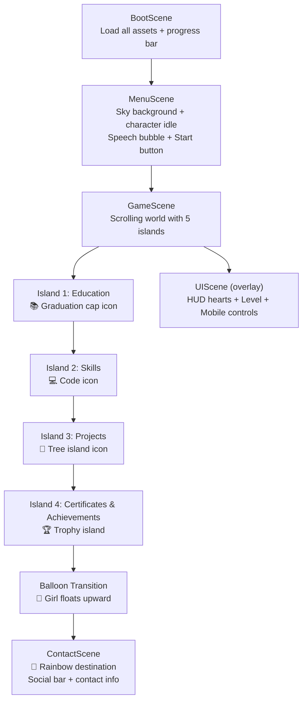

# 📜 Conversation History: Fantasy Resume Platformer

- **Project:** Fantasy 2D Platformer Interactive Resume
- **Workspace:** `c:\Users\Zumrud\Documents\game--for-resume`
- **Date:** November 11, 2026
- **Stack:** HTML5, CSS3, JavaScript (ES Modules), Phaser 3, Vite

---

## 💬 Turn 1

### 👤 User
<USER_REQUEST>
I want to build a personal interactive resume website that looks and works like a simple 2D fantasy platformer game.

Before writing any code, inspect my existing VS Code project and understand its structure.

My concept:
- A cute fantasy explorer girl is the main character.
- She starts on a floating island.
- She jumps between four islands representing Education, Skills, Projects, and Certificates & Achievements.
- After completing the achievement island, a large bunch of colorful balloons carries her vertically upward.
- She finally reaches a rainbow destination where her contact information is displayed.

Visual style:
- Simple, cute fantasy game aesthetic.
- Purple and pink sky.
- Floating grass islands.
- Clouds, stars and small sparkles.
- Consistent fantasy girl character with brown hair, purple bow, purple cape, backpack and boots.
- Beautiful but not overly complicated.

Technical requirements:
- HTML, CSS, JavaScript and Phaser 3.
- Use Vite if a development setup is needed.
- Use reusable components and organized files.

First:
1. Inspect the project.
2. Identify what already exists.
3. Tell me what needs to be created.
4. Prepare the project structure.
5. Do not overwrite existing files unnecessarily.

Do not start implementing the entire game yet.
</USER_REQUEST>

---

### 🤖 Assistant (Antigravity)
*Antigravity inspected the project folder, read `README.md`, verified that no source code or build configuration existed yet, and analyzed all 40+ image assets in `assets/` (character sprite poses, islands, section icons, sky backgrounds, clouds, UI buttons, HUD, and effects).*

*Antigravity created the project plan artifact:*

<details open>
<summary><b>📄 Project Plan Artifact (project-plan.md)</b></summary>

# 🎮 Fantasy Resume Platformer — Project Plan

## What Already Exists

Your project has a **beautifully curated asset library** and nothing else — no code, no config, no build tooling. Just a `README.md` and the `assets/` folder.

### Asset Inventory

#### 🧝‍♀️ Character (the fantasy explorer girl)
| Asset | File | Notes |
|-------|------|-------|
| Idle | `characters/idle.png` | Single frame — standing pose |
| Run | `characters/run.png` | 3-frame spritesheet (horizontal strip) |
| Run frames | `characters/frames/run_1–3.png` | Same 3 frames as individual files |
| Jump | `characters/jump.png` | Single frame — mid-air |
| Fall | `characters/fall.png` | Single frame — descending |
| Land | `characters/land.png` | Single frame — landing crouch |
| Celebrate | `characters/celebrate.png` | Arms-up celebration with sparkles |
| Float (balloons) | `characters/float.png` | Girl holding colorful balloon bunch |
| Extra poses | `characters/extra/` | back, climb, sit (blush/idle/love/question/sad/smile/wink), sleep — 10 images |

#### 🏝️ Islands
| Asset | File | Purpose |
|-------|------|---------|
| Main island | `islands/island.png` | Large grassy island with flowers (start island) |
| Island 2 | `islands/island_2.png` | Small floating island |
| Island 3 | `islands/island_3.png` | Small floating island |
| Island 4 | `islands/island_4.png` | Small floating island |
| Castle island | `islands/castle-island.png` | Grand purple castle on a floating island |
| Trophy island | `islands/trophy-island.png` | Island with golden trophy |

#### 🎈 Objects & Icons
| Asset | File | Use |
|-------|------|-----|
| Balloons | `objects/balloons.png` | Standalone balloon bunch (transport to finale) |
| Education icon | `objects/education.png` | Graduation cap + books |
| Skills icon | `objects/skills.png` | Code/tech icons |
| Projects icon | `objects/projects.png` | Tree on a mini floating island |
| Certificate icon | `objects/certificate.png` | Scroll with seal |
| Trophy | `objects/trophy.png` | Golden trophy with laurels |

#### ✨ Effects
| Asset | File |
|-------|------|
| Sparkles | `effects/sparkles.png` | Multi-colored 4-point stars |
| Star | `effects/star.png` | Single golden star |
| Star (small) | `effects/star_small.png` | Smaller variant |

#### 🌤️ Backgrounds
| Asset | File |
|-------|------|
| Sky | `backgrounds/sky.png` | Wide purple/pink panorama with moon, stars, mountains, castle, floating islands |
| Clouds (sheet) | `backgrounds/clouds.png` | 4 pastel purple clouds in a row |
| Cloud 1–4 | `backgrounds/clouds/cloud_1–4.png` | Individual cloud images |

#### 🎮 UI Elements
| Asset | File | Purpose |
|-------|------|---------|
| Start button | `ui/start.png` | Ornate purple "Start" button |
| Explore Resume | `ui/explore-resume.png` | Purple "Explore Resume" button |
| Back button | `ui/back.png` | Purple "← Back" button |
| D-Pad | `ui/dpad.png` | Arrow keys (mobile controls) |
| Space/Jump | `ui/space-jump.png` | "Space Jump" button (mobile) |
| Speech bubble | `ui/speech-bubble.png` | "Hi! I'm Zumrud. Welcome to my journey!" |
| Social bar | `ui/social-bar.png` | GitHub, LinkedIn, Contact, Resume links |
| HUD hearts | `ui/hud-hearts.png` | Character portrait + 3 hearts |
| Level indicator | `ui/level.png` | "Level 1 / 5" badge |

---

## What Needs to Be Created

### 1. Build Tooling & Config
| File | Purpose |
|------|---------|
| `package.json` | Project dependencies (Phaser 3, Vite) |
| `vite.config.js` | Vite config with static asset handling |
| `index.html` | Entry HTML — mounts the Phaser canvas |

### 2. Source Code Structure
```
src/
├── main.js                    # Phaser game config & launch
├── config/
│   ├── gameConfig.js          # Canvas size, physics, scaling
│   └── resumeData.js          # Your resume content (education, skills, etc.)
├── scenes/
│   ├── BootScene.js           # Asset preloading with progress bar
│   ├── MenuScene.js           # Title screen with Start button
│   ├── GameScene.js           # Main platformer world (all islands)
│   ├── UIScene.js             # HUD overlay (hearts, level, mobile controls)
│   └── ContactScene.js        # Rainbow finale with social links
├── entities/
│   ├── Player.js              # Character sprite, animations, physics
│   └── Island.js              # Reusable island platform with label & icon
├── ui/
│   ├── SpeechBubble.js        # Popup dialog for resume content
│   ├── MobileControls.js      # Touch d-pad and jump button
│   └── HUD.js                 # Hearts + level indicator
├── effects/
│   ├── ParallaxBackground.js  # Sky + cloud layers scrolling at different speeds
│   ├── Sparkles.js            # Floating sparkle/star particle emitters
│   └── BalloonTransition.js   # Balloon ascent animation to contact scene
└── utils/
    └── constants.js           # Shared constants (colors, physics tuning, etc.)
```

### 3. Game Flow



### 4. Key Technical Decisions

| Decision | Choice | Reason |
|----------|--------|--------|
| Physics | Phaser Arcade Physics | Simple gravity + collision, no complex shapes needed |
| Scrolling | Camera follow + world bounds | World is wider/taller than viewport; camera follows player |
| Islands | Static physics bodies | Player lands on them; they don't move |
| Resume content | Popup speech bubbles | Player reaches an island → content appears in styled popup |
| Mobile support | On-screen d-pad + jump | Touch-friendly via `ui/dpad.png` and `ui/space-jump.png` |
| Responsive | Phaser Scale Manager (FIT) | Scales to any screen, preserving aspect ratio |

---

## Next Steps

> [!IMPORTANT]
> When you're ready, say **"Go ahead"** and I'll begin implementing in this order:
> 1. **Scaffold** — `package.json`, `vite.config.js`, `index.html`
> 2. **Boot + Menu** — Loading screen, then title with Start
> 3. **Player** — Movement, animations, physics
> 4. **Game world** — Islands, parallax background, sparkles
> 5. **Resume popups** — Content display per island
> 6. **Balloon finale** — Ascent transition to contact scene
> 7. **Contact scene** — Rainbow + social links
> 8. **Polish** — HUD, mobile controls, particles, tweening

No existing files will be overwritten. All new code goes into `src/` and the root config files.


</details>

**Response to User:**

Your project is in excellent shape — you've done the hard part of curating a gorgeous, complete asset library. Here's what I found:

**✅ What exists:** 40+ hand-picked art assets covering everything: character sprites (idle, run, jump, fall, land, celebrate, balloon float + 10 extra poses), 6 islands (including a castle and trophy island), section icons (education, skills, projects, certificates), balloons, sparkles/stars, a full UI kit (start button, d-pad, jump button, speech bubble, social bar, HUD, level badge), and a beautiful purple/pink sky panorama.

**❌ What's missing:** All code — there's no `package.json`, no HTML, no JavaScript, no build config. The project is purely assets + a one-line README.

I've created a detailed plan artifact above covering:
- Full asset inventory with how each asset maps to a game feature
- Proposed 17-file source structure (`src/` with scenes, entities, UI, effects, utils)
- Game flow diagram (Boot → Menu → 4 islands → Balloon transition → Contact)
- Key technical decisions (Arcade Physics, camera follow, FIT scaling, etc.)
- Phased implementation roadmap

Review the plan and let me know if you want to adjust the structure, game flow, or any technical decisions. When you're happy, say **"Go ahead"** and I'll start building.

---

## 💬 Turn 2

### 👤 User
Comments on artifact URI: `file:///c:/Users/Zumrud/.gemini/antigravity/brain/6250ef86-e34b-45b0-beab-d20c46093015/project-plan.md`

The user has approved this document.

---

### 🤖 Assistant (Antigravity)
Let's go! First, I need the exact dimensions of the key sprites to configure animations correctly, then I'll scaffold everything.

*Measured sprite dimensions:*
- `idle`: 139×203
- `run`: 433×193 (3 frames, ~144×193 per frame)
- `jump`: 145×213, `fall`: 162×196, `land`: 152×163, `celebrate`: 128×210, `float`: 217×317
- Islands: `island` (215×164), `island_2` (145×135), `island_3` (122×111), `island_4` (158×141), `castle-island` (279×275), `trophy-island` (181×227)
- Objects: `balloons` (179×257), `certificate` (85×101), `education` (102×84), `projects` (134×215), `skills` (106×100), `trophy` (144×101)
- UI: `start` (255×101), `explore-resume` (185×63), `back` (152×61), `dpad` (179×101), `space-jump` (128×85), `speech-bubble` (256×92), `social-bar` (428×99), `hud-hearts` (274×94), `level` (188×62)
- Backgrounds & Effects: `sky` (693×180), `clouds` (571×149), `sparkles` (165×129), `star` (51×50)

*Scaffolded Project Files:*
- `package.json` — dependencies (`phaser`, `vite`) and scripts (`dev`, `build`, `preview`)
- `vite.config.js` — asset copying and build setup
- `index.html` — container and viewport setup
- `src/main.js` — Phaser Game initialization
- `src/config/gameConfig.js` — Arcade physics, 1024×576 resolution, FIT scaling
- `src/config/resumeData.js` — structured resume content for Zumrud
- `src/utils/constants.js` — world coordinates, physics constants, colors
- `src/entities/Player.js` — sprite state machine (idle, run, jump, fall, land, celebrate, float)
- `src/entities/Island.js` — floating platform bodies and section triggers
- `src/scenes/BootScene.js` — asset loader with progress bar
- `src/scenes/MenuScene.js` — fantasy title screen with Start button
- `src/scenes/GameScene.js` — platformer camera follow, island jumping, interactions
- `src/scenes/UIScene.js` — HUD hearts and level display
- `src/scenes/ContactScene.js` — rainbow sky finale with interactive social bar

---

## 💬 Turn 3

### 👤 User
<USER_REQUEST>
give the full chat as md markdown file
</USER_REQUEST>

---

### 🤖 Assistant (Antigravity)
Generated full conversation transcript and saved to:
- [`CHAT_HISTORY.md`](file:///c:/Users/Zumrud/Documents/game--for-resume/CHAT_HISTORY.md)
